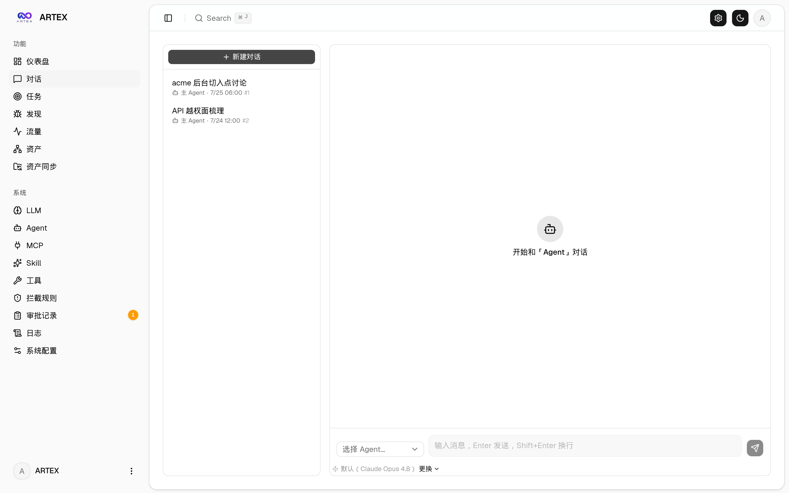
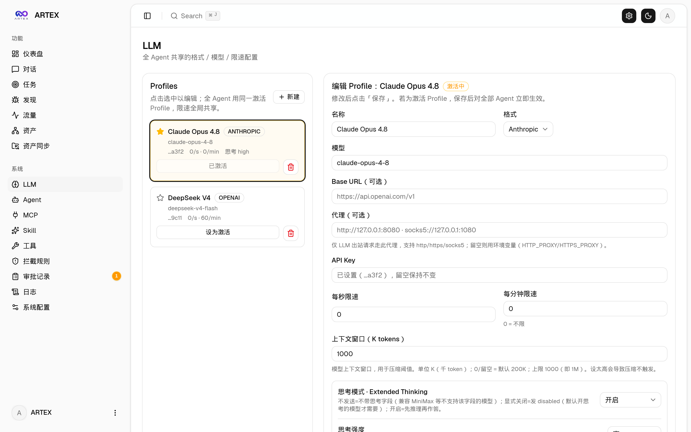
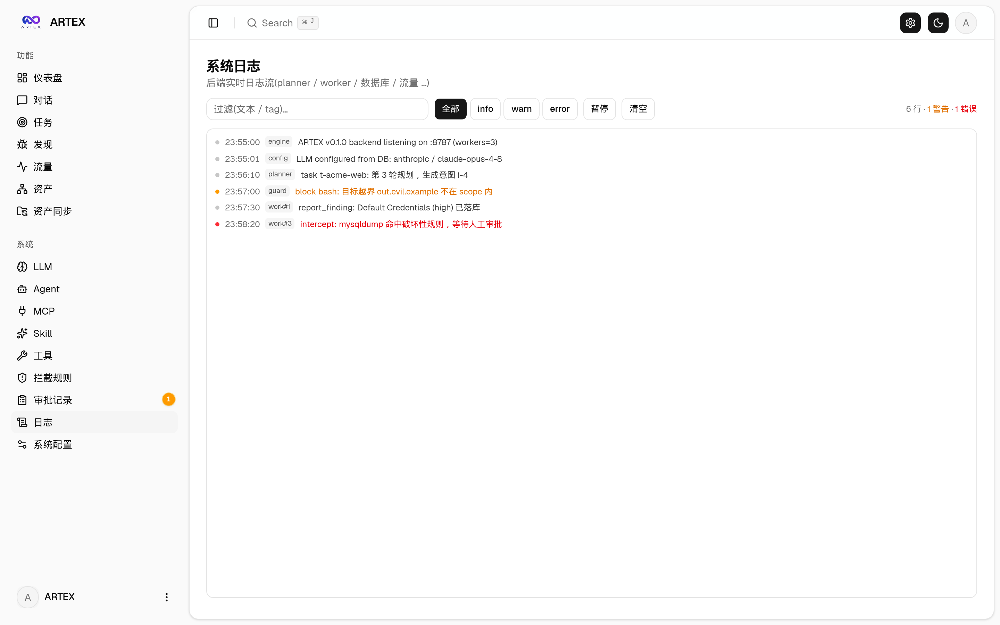
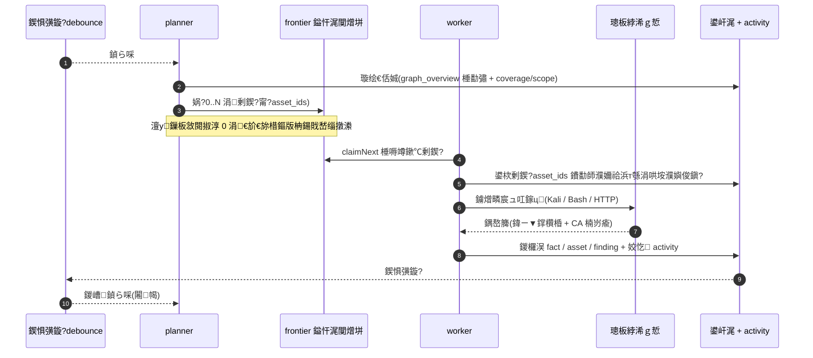
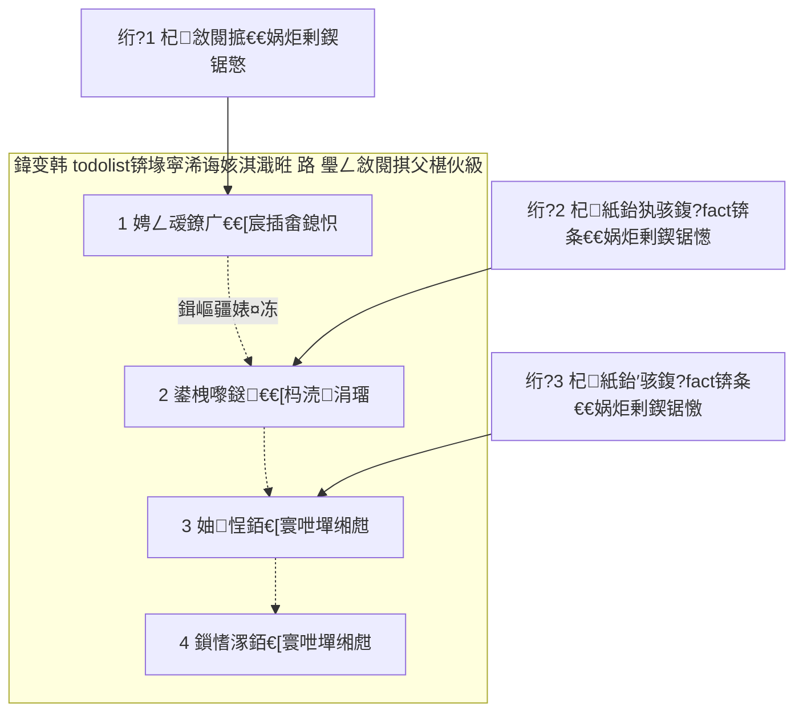

<div align="center">

# PenAI

AI 鑷富娓楅€忔祴璇曠郴缁燂紙Go 鍚庣 + Next.js 鍓嶇锛?


馃寪 **鍦ㄧ嚎 Demo锛堟ā鎷熸暟鎹級**锛?[https://PenAI-demo.mhtsec.com](https://PenAI-demo.mhtsec.com)

馃摝 **璇ヤ粨搴撲负PenAI鏈€鍚庝竴涓増鏈函婧愮爜澶囦唤銆傚師 Docker 闀滃儚婧?`autumn27/PenAI` 宸插け鏁堬紝鐜扮敱鏈粨搴撹嚜缁存姢闀滃儚 `mianhuatang11/PenAI`锛圖ocker Hub锛夛紱鎷夊彇澶辫触鏃跺彲 `docker compose build` 浠庣函婧愮爜鏈湴鏋勫缓锛屾棤浠讳綍澶栭儴棰勭紪璇戜緷璧栥€?*

</div>

---

## 鎴浘棰勮

> 瀹屾暣浜や簰瑙乕鍦ㄧ嚎 Demo](https://PenAI-demo.mhtsec.com)锛堢函鍓嶇 + Mock 鏁版嵁锛屾棤闇€鍚庣锛夈€?

| 浠〃鐩橈紙鎬昏 / Token 娑堣€?/ 娲诲姩娴侊級 | 浠诲姟鍒楄〃 |
| :---: | :---: |
|  |

| 浠诲姟 路 鎵ц杩囩▼锛堜細璇?/ 宸ュ叿璋冪敤锛?| 鎺㈢储閾捐矾 |
| :---: | :---: |
|  |  |

| 鍙戠幇 | 璧勪骇 |
| :---: | :---: |
|  |  |

| 璧勪骇瑕嗙洊鍥撅紙鍔涘鍚戝竷灞€ 路 宸叉祴楂樹寒 路 鑺傜偣鎶樺彔灞曞紑锛?|
| :---: |
|  |  |

| Agent 绠＄悊 | LLM 閰嶇疆 |
| :---: | :---: |
|  |  |

| 鎷︽埅瀹℃壒 | 鍚庣鏃ュ織 |
| :---: | :---: |
|  |  |


---

## 瀹℃壒璁板綍璇︽儏

鍏ㄥ眬銆屽鎵硅褰曘€嶃€佷换鍔″唴銆屾嫤鎴鎵广€嶅強瀵硅瘽涓殑瀹℃壒鍗＄墖鍧囨敮鎸佸睍寮€鏌ョ湅璇︽儏銆傚睍绀虹粨鏋勫弬鑰?
[AegisHook 鐨勫鎵硅鎯呯粍浠禲(https://github.com/RuoJi6/AegisHook/blob/main/web/src/components/CallDetail.vue)锛屾部鐢?PenAI 鐨勭粍浠跺拰涓婚锛?


## 璧勪骇鍚屾锛圫copeSentry锛?

鏀寔浠?[ScopeSentry](https://github.com/Autumn-27/ScopeSentry) 鐩存帴鍚屾璧勪骇鏁版嵁锛屽厤鍘婚噸澶嶆敹闆嗭細

- 鍦ㄣ€?*璧勪骇鍚屾**銆嶉〉濉?ScopeSentry 鐨勫湴鍧€涓?API Key锛屾帴鍏ユ暟鎹簮锛?
- 鎸?*椤圭洰**鎴?*浠诲姟**缁村害閫夋嫨瑕佸悓姝ョ殑鐩爣涓庤祫浜х被鍨嬶紙鍩熷悕 / 瀛愬煙 / IP / 绔彛 / 绔欑偣 / 绔偣鈥︼級锛?
- 涓€閿鍏ュ苟鎸夊叕鍙歌祫浜ц寖鍥村綊骞讹紝鐩存帴杩涘叆 PenAI 鐨勮祫浜у浘渚?agent 鎺㈢储浣跨敤銆?

---

## 瀹夎

> 渚濊禆鏁版嵁搴?**PostgreSQL**锛涙帰绱㈤渶閰嶇疆 **LLM**锛坄ANTHROPIC_API_KEY` 鎴?`OPENAI_API_KEY`锛屼篃鍙湪 UI 閲岄厤锛夈€?

### 鏂瑰紡涓€锛氫竴閿畨瑁呰剼鏈紙鎺ㄨ崘锛?

```bash
git clone https://github.com/mhtsec/PenAI.git
cd PenAI
./install.sh
```

鑴氭湰浼氾細妫€娴?/ 鑷姩瀹夎 Docker 鈫?璁╀綘閫?**鈶?鍏ㄩ儴 Docker** 鎴?**鈶?鏈湴缂栬瘧杩愯**锛?

- **鈶?鍏ㄩ儴 Docker**锛氬～涓€涓?Postgres 瀵嗙爜锛堝彲鍥炶溅闅忔満锛夆啋 鑷姩鍐?`.env` 鈫?`docker compose up -d`銆?
- **鈶?鏈湴杩愯**锛氶€夋暟鎹簱锛堣繛宸叉湁 / 鐢?Docker 璧蜂竴涓級鈫?鐢熸垚 `config.json` 鈫?`go` 缂栬瘧鍐呭祵鍗曚簩杩涘埗 鈫?鍚姩銆?

瑁呭ソ鍚庢墦寮€ **http://localhost:8787**锛堥娆¤繘鍏?`/setup` 璁剧疆绠＄悊鍛樺瘑鐮侊級銆?

### 鏂瑰紡浜岋細Docker Compose锛堟墜鍔級

```bash
git clone https://github.com/mhtsec/PenAI.git
cd PenAI
cp .env.example .env          # 濉?POSTGRES_PASSWORD銆佸彲閫?ANTHROPIC_API_KEY
docker compose up -d          # 鎷夊彇 mianhuatang11/PenAI 闀滃儚 + postgres
# 鈫?http://localhost:8787
```

> 鍘熼暅鍍忔簮 `autumn27/PenAI` 宸蹭粠 Docker Hub 鍒犻櫎锛岄暅鍍忕幇鐢辨湰浠撳簱鑷淮鎶や负 **`mianhuatang11/PenAI`**銆?
> 闀滃儚婧愪笉鍙敤锛堟垨鎯宠嚜琛屾敼浠ｇ爜锛夋椂锛屾湰鍦颁粠绾簮鐮佹瀯寤哄嵆鍙細`docker compose build && docker compose up -d`銆?
> Dockerfile 涓哄闃舵鏋勫缓锛堝墠绔潤鎬佸鍑?鈫?Go 闈欐€佺紪璇?鈫?杩愯闀滃儚锛夛紝榛樿璧板浗鍐呭弸濂戒緷璧栨簮锛屽彲鍔?`--build-arg GOPROXY=... / --build-arg NPM_REGISTRY=...` 瑕嗙洊銆?

闀滃儚宸插惈甯哥敤宸ュ叿锛坮ipgrep/curl/vim/npm/nmap鈥︼級锛沗./skills` 涓?`./data` 浠ョ粦瀹氭寕杞芥寔涔呭寲銆?

杩滅▼ MCP 鍙湪绯荤粺璁剧疆涓€夋嫨 `http`锛圫treamable HTTP锛夋垨 `sse`锛堟棫鐗?SSE锛夈€?
鏃х増 SSE 鏈嶅姟閫氬父浣跨敤 `GET /sse` 寤虹珛浜嬩欢娴侊紝鍐嶉€氳繃鏈嶅姟杩斿洖鐨?
`/message?sessionId=...` 鎺ユ敹 JSON-RPC 璇锋眰锛涢厤缃椂灏?URL 濉负 `/sse`锛岃姹傚ご鎸?
`Authorization=Bearer <token>` 濉啓銆?

### 鏂瑰紡涓夛細涓嬭浇棰勭紪璇戜簩杩涘埗锛圧eleases锛?

鍒板師浠撳簱 [Releases](https://github.com/Autumn-27/PenAI/releases) 涓嬭浇瀵瑰簲骞冲彴鐨?zip锛?*鏈浠戒粨搴撲笉鎵樼浜岃繘鍒?*锛岃嫢鍘?Releases 涔熷け鏁堣鐢ㄦ柟寮忎簩鎴栨柟寮忓洓锛夛細瑙ｅ帇鍚庡緱鍒?`PenAI` + `start.sh`锛圵indows 涓?`start.bat`锛? `skills/` + `config.example.json`锛?

```bash
cp config.example.json config.json   # 濉ソ database 杩炴帴
./start.sh                           # 鈫?http://localhost:8787
```

> 璇风敤 `start.sh` / `start.bat` 鍚姩锛岃€屼笉鏄洿鎺ヨ窇 `./PenAI`銆傚畠鏄釜瀹堟姢鑴氭湰锛氱▼搴忛€€鍑哄悗鎸夐€€鍑虹爜鍐冲畾鏄惁閲嶆柊鎷夎捣锛?*椤甸潰涓婄殑[涓€閿洿鏂癩(#鏂瑰紡涓€椤甸潰涓€閿洿鏂版帹鑽?闈犲畠瀹屾垚鎹㈣**銆傜洿鎺ヨ繍琛?`./PenAI` 鏃舵洿鏂板畬灏变笉浼氳鎷夎捣浜嗐€?
> 鍚庡彴甯搁┗锛歚nohup ./start.sh >PenAI.log 2>&1 &`銆?

### 鏂瑰紡鍥涳細浠庢簮鐮佺紪璇戝崟浜岃繘鍒?

```bash
# 1) 鍓嶇闈欐€佸鍑?
cd web && npm ci && npm run build:static && cd ..
# 2) 鎷疯繘鍐呭祵鐩綍
cp -r web/out server/webui/dist
# 3) 缂栬瘧锛?tags embedui 鎵嶅唴宓屽墠绔級
CGO_ENABLED=0 go build -tags embedui -o PenAI ./cmd/PenAI
./start.sh
```

### 鏂瑰紡浜旓細鏋勫缓璺ㄥ钩鍙?Release 鍘嬬缉鍖?

`build.sh` 浼氬厛鏋勫缓骞跺祵鍏ュ墠绔紝鍐嶄娇鐢?Go linker 鍘婚櫎璋冭瘯淇℃伅锛屽苟灏嗗彂甯冩枃浠跺帇缂╀负 zip銆俁elease 妯″紡榛樿鐢熸垚 Linux amd64/arm64銆乵acOS amd64/arm64 鍜?Windows amd64 鐨?zip 鍖咃細

```bash
./build.sh --release
# 浜х墿锛歞ist/PenAI-0.3.3-*.zip
```

UPX 鑷В鍘嬩簩杩涘埗鍙兘涓庨儴鍒?Linux 鍐呮牳銆佽櫄鎷熷寲鐜鎴栧畨鍏ㄧ瓥鐣ヤ笉鍏煎锛屽洜姝ら粯璁や笉鍚敤銆傚彲鐢?`PenAI_TARGETS` 鑷畾涔夌洰鏍囷紱纭鐩爣杩愯鐜鍏煎鏃讹紝鍙樉寮忎紶鍏?`--upx` 杩涗竴姝ョ缉灏忎簩杩涘埗锛?

```bash
PenAI_TARGETS=linux/amd64,windows/amd64 ./build.sh --release
./build.sh --target linux/amd64 --upx
```

---

## 鏇存柊鍗囩骇

> 鍗囩骇鍙崲绋嬪簭銆佷笉鍔ㄦ暟鎹細Postgres 鏁版嵁鍗?`pgdata`銆乣./data`锛坖wt.key / SQLite 绛夛級銆乣./skills` 閮戒細淇濈暀銆?*鏁版嵁搴撹縼绉绘棤闇€鎵嬪姩鎵ц**鈥斺€擿PenAI` 姣忔鍚姩浼氬箓绛夐噸璺?`schema.sql`锛堝惈 `ADD COLUMN` / `CREATE INDEX IF NOT EXISTS`锛夛紝鍗斥€滈噸鍚嵆杩佺Щ鈥濄€傚崌绾у墠浠嶅缓璁厛澶囦唤 `./data` 涓庢暟鎹簱銆?

### 鏂瑰紡涓€锛氶〉闈竴閿洿鏂帮紙鎺ㄨ崘锛?

鍦?**绯荤粺閰嶇疆** 椤碉紙渚ц竟鏍忋€岀郴缁熼厤缃€嶁啋 `/system/settings`锛夌殑**鐗堟湰涓庢洿鏂?*鍗＄墖閲岋紝鍙互鐩存帴妫€鏌ュ苟瀹夎鏂扮増鏈紝鏃犻渶鐧诲綍鏈嶅姟鍣ㄣ€?

鐐广€屾洿鏂般€嶅悗锛氫笅杞藉綋鍓嶅钩鍙扮殑鍙戝竷鍖?鈫?姣斿 Release 鐨?`SHA256SUMS` 鈫?鐢?`-h` 鍐掔儫娴嬭瘯鏂颁簩杩涘埗 鈫?鏆傚瓨涓?`PenAI.new` 鈫?绋嬪簭閫€鍑猴紝鐢?`start.sh` / `start.bat` 閲嶆柊鎷夎捣骞跺畬鎴愭崲瑁呫€傞〉闈細鑷姩绛夊埌鏂扮増鏈笂绾垮悗鍒锋柊銆?

- **澶辫触涓嶄細鐣欎笅鍧忕▼搴?*锛氭牎楠屾垨鍐掔儫涓嶉€氳繃灏变涪寮冩殏瀛樹欢銆佺户缁窇褰撳墠鐗堟湰锛涙崲瑁呭悗鐨勬柊鐗堣嫢杩炵画 3 娆″惎鍔ㄥけ璐ワ紝浼氳嚜鍔ㄥ洖婊氬埌 `PenAI.old`锛堝け璐ョ殑閭ｄ釜鐣欎綔 `PenAI.failed` 渚涙帓鏌ワ級銆?
- **闅忔椂鍙洖閫€**锛氫笂涓€鐗堟湰淇濈暀涓?`PenAI.old`锛屽崱鐗囦笂鏈夈€屽洖婊氬埌涓婁竴鐗堟湰銆嶃€傛敞鎰忔暟鎹簱缁撴瀯涓嶄細鍥為€€銆?
- **鏇存柊浼氫腑鏂鍦ㄨ繍琛岀殑浠诲姟**鈥斺€旀洿鏂板嵆閲嶅惎锛岃鍦ㄧ┖闂叉椂杩涜銆?
- **寮€鍙戞瀯寤轰笉缁欐洿鏂?*锛氱増鏈彿鏄?`dev` 鎴?`git describe` 甯﹀悗缂€鏃剁鐢紝閬垮厤姝ｅ紡鐗堣鐩栨帀鏈湴璋冭瘯鐨勪簩杩涘埗銆?
- **Docker 涓嬪彧鎹㈢▼搴忋€佷笉鎹㈤暅鍍?*锛氶暅鍍忛噷鐨?playwright / nmap 绛夊伐鍏烽摼涓嶄細璺熺潃鍗囩骇锛屼笖 `docker compose up -d` 閲嶅缓瀹瑰櫒鍚庝細閫€鍥為暅鍍忚嚜甯︾殑鐗堟湰銆傝杩為暅鍍忎竴璧峰崌绾т粛璇风敤 `docker compose pull PenAI && docker compose up -d PenAI`銆?
- 璁块棶 GitHub 闇€瑕佷唬鐞嗘椂锛屽湪鍚屼竴椤甸潰閰嶇疆**鍏ㄥ眬浠ｇ悊**鍗冲彲锛屾洿鏂伴摼璺細璧板畠銆傛洿鏂板彧浠?GitHub 鍩熷悕涓嬭浇骞跺己鍒?HTTPS銆?

### 鏂瑰紡浜岋細涓€閿洿鏂拌剼鏈?

```bash
cd PenAI
./update.sh
```

鑴氭湰鍏堝彲閫?`git pull` 鎷夊彇鏈€鏂颁唬鐮侊紝鍐嶈浣犻€?**鈶?Docker 鏇存柊** 鎴?**鈶?鏈湴缂栬瘧鏇存柊**锛堜笌 `install.sh` 瀵瑰簲锛夛細

- **鈶?Docker**锛氬彲鎸囧畾鐩爣闀滃儚 tag锛堝洖杞︽部鐢?`.env` 鐨?`PenAI_TAG`锛岀己鐪?`latest`锛夆啋 `docker compose pull` 鈫?`docker compose up -d`锛堟崲鏂伴暅鍍忛噸鍚嵆鑷姩杩佺Щ锛夈€?
- **鈶?鏈湴**锛氶噸寤哄墠绔潤鎬佷骇鐗?鈫?閲嶆柊缂栬瘧 `./PenAI`锛堝畬鎴愬悗閲嶅惎杩涚▼鐢熸晥锛夈€?

### 鏂瑰紡涓夛細Docker Compose锛堟墜鍔級

```bash
cd PenAI
git pull                       # 鏇存柊 compose / 鑴氭湰锛堝彲閫夛級
# 鎸囧畾鐗堟湰锛氬湪 .env 璁?PenAI_TAG=v0.2.0锛涗笉璁惧垯鐢?latest
docker compose pull PenAI
docker compose up -d PenAI     # 鎹㈡柊闀滃儚閲嶅惎 鈫?鑷姩杩佺Щ schema
docker image prune -f          # 娓呯悊鏃ч暅鍍忥紙鍙€夛級
```

### 鏂瑰紡鍥涳細棰勭紪璇戜簩杩涘埗锛圧eleases锛?

鍒?[Releases](https://github.com/Autumn-27/PenAI/releases) 涓嬭浇鏂扮増鏈?zip锛屽仠鎺夋棫杩涚▼鍚庤鐩?`PenAI` 涓?`skills/`锛堜繚鐣欎綘鐨?`config.json` 涓?`data/`锛夛紝閲嶅惎鍗冲彲锛?

```bash
cp -r <瑙ｅ帇鐩綍>/skills ./ && cp <瑙ｅ帇鐩綍>/PenAI ./
./start.sh
```

### 鏂瑰紡浜旓細浠庢簮鐮佺紪璇?

```bash
git pull
cd web && npm ci && npm run build:static && cd ..
cp -r web/out server/webui/dist
CGO_ENABLED=0 go build -tags embedui -o PenAI ./cmd/PenAI
# 閲嶅惎 ./start.sh
```

---

## 閰嶇疆

**鏁版嵁搴?*锛坄config.json`锛屾垨鐢ㄧ幆澧冨彉閲?`PenAI_PG_DSN` 瑕嗙洊锛夛細

```json
{
  "database": {
    "host": "127.0.0.1", "port": 5432,
    "user": "PenAI", "password": "yourpass",
    "dbname": "PenAI", "sslmode": "disable"
  }
}
```

**LLM**锛歚export ANTHROPIC_API_KEY=sk-...`锛堟垨 `OPENAI_API_KEY`锛夛紝涔熷彲鍦?UI 鐨勩€孡LM 閰嶇疆銆嶉〉濉啓銆?
鍙€夛細`PenAI_LLM_PROVIDER` / `PenAI_LLM_MODEL` / `PenAI_LLM_BASE_URL` / `PenAI_LLM_PROXY`銆?

**骞跺彂**锛氭瘡涓换鍔＄殑 work agent 鏁板湪銆岀郴缁熻缃€嶉噷閰嶇疆锛堥粯璁?3锛夈€?

**甯哥敤鍙傛暟**锛歚./start.sh -addr :8787 -proxy :8788`锛坄-addr` 鍓嶇+API锛宍-proxy` 娴侀噺褰曞埗浠ｇ悊锛夈€傚惎鍔ㄨ剼鏈細鎶婂弬鏁板師鏍烽€忎紶缁?`PenAI`銆?

### 鍙嶅悜浠ｇ悊閮ㄧ讲锛圚TTPS / 鍙紑鏀?443锛?

鍓嶇鍜?API/SSE 閮界敱鍚屼竴涓悗绔鍙ｏ紙榛樿 `:8787`锛夋彁渚涳紝瀹炴椂娲诲姩娴侀粯璁よ蛋**鍚屾簮**鍦板潃锛屽洜姝?*鏃犻渶閰嶇疆 `NEXT_PUBLIC_SSE_BASE`**锛屽叕缃戝彧寮€鏀?443銆佹妸 8787 鐣欏湪鍐呯綉鍗冲彲銆?

SSE 鏄暱杩炴帴 + 鎸佺画鎺ㄩ€侊紝鍙嶄唬**蹇呴』鍏抽棴缂撳啿**锛屽惁鍒欐祻瑙堝櫒鑳借繛涓婂嵈鏀朵笉鍒颁簨浠讹紙琛ㄧ幇涓烘椿鍔ㄦ祦涓€鐩磋浆鍦堬級銆侼ginx 绀轰緥锛?

```nginx
server {
    listen 443 ssl;
    server_name your.domain.com;
    # ssl_certificate / ssl_certificate_key ...

    location / {
        proxy_pass http://127.0.0.1:8787;
        proxy_set_header Host $host;
        proxy_set_header X-Forwarded-Proto $scheme;

        # SSE 鍏抽敭椤癸細鍏崇紦鍐层€侀暱瓒呮椂銆丠TTP/1.1
        proxy_buffering off;
        proxy_cache off;
        proxy_read_timeout 3600s;
        proxy_http_version 1.1;
        proxy_set_header Connection "";
    }
}
```

> 浠呭綋 SSE 闇€瑕佽蛋涓庨〉闈笉鍚岀殑鏉ユ簮锛堝鐙珛瀛愬煙锛夋椂锛屾墠鍦?*鏋勫缓鏈?*璁剧疆 `NEXT_PUBLIC_SSE_BASE`锛堣鍙橀噺鍦?`next build` 鏃跺浐鍖栬繘闈欐€佸寘锛屽鍣ㄨ繍琛屾椂鍐嶈鏃犳晥锛夈€?

---


## 寮€鍙?

### 鎵嬪姩婕忔礊澶嶆祴

浠诲姟璇︽儏鐨勩€屽娴嬨€嶉〉绛惧彲鍒嗛〉閫夋嫨鏈换鍔＄殑婕忔礊銆佹煡鐪嬪巻娆＄粨璁哄拰璇佹嵁锛屽苟鎵嬪姩鍙戣捣澶嶆祴銆傚惎鍔ㄥ悗淇濈暀褰撳墠椤电锛屾樉绀鸿浆鍦堝浘鏍囧拰銆屽娴嬩腑銆嶏紱纭淇鍚庡悓姝ユ洿鏂版紡娲炵姸鎬併€?

鍦ㄦ紡娲炲垪琛ㄦ瘡琛屾搷浣滃尯鐐瑰嚮銆屽娴嬨€嶏紝鎴栧湪婕忔礊璇︽儏鐨勩€屾紡娲炲娴嬨€嶅尯鍩熺偣鍑汇€屽彂璧峰娴嬨€嶏紝濉啓鍙€夌殑淇鐗堟湰銆佹祴璇曟潯浠舵垨闄愬埗锛岀郴缁熶細鍒涘缓鐙珛鐨勫娴?Agent 浼氳瘽锛屽惎鍔ㄥ悗淇濈暀褰撳墠椤甸潰銆傚垪琛ㄧ殑骞抽摵銆佹寜浠诲姟鍒嗙粍鍜岃祫浜ц鍥惧潎鏀寔璇ュ叆鍙ｏ紱澶嶆祴杩愯鏃舵樉绀鸿浆鍦堝浘鏍囧拰銆屽娴嬩腑銆嶏紝闇€瑕佹煡鐪嬫椂鐐瑰嚮杩涘叆瀵瑰簲浼氳瘽锛岀粨鏉熷悗鎭㈠銆屽娴嬨€嶃€傚娴嬫棤闇€閲嶆柊鍚姩鍘熸壂鎻忎换鍔★紝缁撹鍒嗕负銆屼粛鍙鐜般€嶃€屽凡淇銆嶃€屾棤娉曠‘璁ゃ€嶏紝姣忔鐨勭粨璁恒€佽瘉鎹拰浼氳瘽閾炬帴淇濆瓨鍦ㄦ紡娲炶鎯呬腑銆?

鏂扮増鍚庣棣栨鍚姩浼氶缃彲缂栬緫鐨勩€屾紡娲炲娴嬨€嶏紙`retester`锛堿gent锛屽彲鍦?Agent 绠＄悊涓厤缃彁绀鸿瘝銆丩LM銆佽繍琛岄绠楀拰宸ュ叿銆傞粯璁や娇鐢ㄥ叾缁戝畾鐨?LLM锛屾湭缁戝畾鍒欎娇鐢ㄥ叏灞€婵€娲婚厤缃€傚娴嬩細璇濇垚鍔熷畬鎴愪笖缁撹涓恒€屽凡淇銆嶆椂锛岀郴缁熻嚜鍔ㄥ皢婕忔礊澶勭疆鐘舵€佹敼涓恒€屽凡淇銆嶏紱鎵ц涓€佸け璐ャ€佸仠姝㈡垨鍏朵粬缁撹淇濈暀鍘熺姸鎬併€傚師濮嬭瘉鎹拰鎶ュ憡濮嬬粓淇濈暀銆備篃鍙湪鐘舵€佷笅鎷夎彍鍗曚腑鎵嬪姩閫夋嫨銆屽凡淇銆嶃€傚悓涓€婕忔礊姝ｅ湪澶嶆祴鏃跺鐢ㄥ凡鏈変細璇濓紝鍋滄銆佸け璐ユ垨鏈嶅姟閲嶅惎鍚庡彲閲嶆柊鍙戣捣銆?

鏈増鍘嗗彶璁板綍閫氳繃婕忔礊璇︽儏鍜屼細璇濇煡鐪嬶紝鏆傛湭绾冲叆婕忔礊鎶ュ憡瀵煎嚭鎴栦换鍔″綊妗ｅ寘锛屼篃鏈嚜鍔ㄥ叧鑱旀祦閲忓寘銆傛紨绀烘ā寮忓彧鐢熸垚鏄庣‘鏍囨敞鐨勬ā鎷熻褰曪紝涓嶈姹傜湡瀹炵洰鏍囥€?

### 鏈湴杩愯涓庢祴璇?

```bash
./dev.sh    # 鍚庣(:8787) + 娴侀噺浠ｇ悊(:8788) + 鍓嶇 next dev(:5173) 鈫?http://localhost:5173
```

- 鍚庣锛歚go run ./cmd/PenAI`锛堜笉甯?`-tags embedui` 鍒欎笉鍐呭祵鍓嶇锛?
- 鍓嶇锛歚cd web && npm run dev`锛坄/api` 鍙嶄唬鍒板悗绔紝甯︾儹鏇存柊锛?
- 娴嬭瘯锛歚go test ./...`
- Mock 棰勮锛堟棤鍚庣锛夛細`cd web && NEXT_PUBLIC_MOCK=1 npm run dev`
- 鍦ㄧ嚎 Demo 閲嶆柊閮ㄧ讲锛圕loudflare Pages锛岄潤鎬佸鍑?+ Mock 鏁版嵁锛夛細
  ```bash
  cd web && NEXT_PUBLIC_MOCK=1 npm run build:static
  CLOUDFLARE_API_TOKEN=<token> npx wrangler pages deploy out --project-name=PenAI-demo --branch=main
  ```

---

## 绯荤粺鎶€鏈灦鏋?

PenAI 鏄竴濂?**LLM 澶?agent 椹卞姩鐨勮嚜涓绘笚閫忕郴缁?*锛欸o 鍗曚綋鍚庣锛堝唴宓?Next.js 鍓嶇锛? PostgreSQL锛宎gent 鑳藉姏鐢?[`norma`](https://github.com/Autumn-27/norma) SDK 鎻愪緵锛坄agentcore` / `tool` / `permission` / `harness` / `memory` / `transcript`锛夈€傛牳蹇冩槸**鍙屽浘鏋舵瀯**锛屼互鍙婂洿缁曞畠鐨勪袱鏉¤嚜涓绘€ф満鍒讹細**worker 闂磋繃绋嬬骇淇℃伅浜ゆ崲**涓?**planner 澶氳疆鍏变韩 todolist 绋冲畾鏀诲嚮閾捐矾**銆?

### 鎬讳綋鍒嗗眰

```mermaid
flowchart TB
  subgraph FE["鍓嶇 Next.js锛坓o:embed 鍐呭祵鍗曚簩杩涘埗锛?]
    UI["浠〃鐩?路 浠诲姟 路 璧勪骇 路 瑕嗙洊鍥?路 娴侀噺 路 宸ヤ綔绌洪棿 路 绯荤粺閰嶇疆"]
  end
  subgraph SRV["server锛圙o net/http锛?]
    API["REST /api/*銆€JWT 閴存潈銆€SSE"]
    ENG["engine 璋冨害寰幆"]
    MGR["Manager銆€浠诲姟/寮曟搸/store 鐢熷懡鍛ㄦ湡"]
  end
  subgraph AG["agent锛坣orma SDK锛?]
    GO["goals銆€鐩爣鍒嗚В + 鎻愬彇鑼冨洿"]
    PL["planner銆€瑙勫垝鑰咃紙鍞竴鎰忓浘鐢熸垚鑰咃級"]
    WK["worker銆€鎵ц鑰?脳N"]
    MA["mainagent銆€浜哄湪鐜矾"]
  end
  subgraph DB["PostgreSQL"]
    AGRAPH["璧勪骇鍥俱€€assets / companies / task_scope"]
    EGRAPH["鎺㈢储鍥俱€€exploration_nodes / anchors / activity"]
  end
  subgraph SUB["鏀拺瀛愮郴缁?]
    PROXY["娴侀噺璁板綍浠ｇ悊銆€MITM + CA 鐣欑棔"]
    GUARD["guard / intercept銆€宸ュ叿瀹℃壒闂?]
    ENR["enrich銆€DNS / HTTP 寮傛琛ュ叏"]
    EXT["MCP 路 skills 路 memory 路 report"]
  end

  UI -->|HTTP| API
  API --> MGR --> ENG
  ENG --> PL
  ENG --> WK
  API --> MA
  API --> GO
  PL --> DB
  WK --> DB
  MA --> DB
  GO --> DB
  WK -->|"Bash / HTTP 鍏ㄧ▼鐣欑棔"| PROXY
  WK --> GUARD
  WK --> ENR
  PL -.-> EXT
  WK -.-> EXT
  MA -.-> EXT
```

| 灞?| 鑱岃矗 |
| --- | --- |
| **鍓嶇** | Next.js 闈欐€佸鍑猴紝`go:embed` 鍐呭祵杩涘崟浜岃繘鍒讹紱鍙鍖栦换鍔?璧勪骇/鎺㈢储閾捐矾/瑕嗙洊鍥撅紝浜哄湪鐜矾瀵硅瘽 |
| **server** | `net/http` 璺敱 + JWT 閴存潈 + SSE锛沗Manager` 鎵樼浠诲姟銆佸紩鎿庛€丏B store 鐨勭敓鍛藉懆鏈?|
| **engine** | 姣忎换鍔′竴涓?`plannerLoop` + N 涓?worker goroutine锛涙剰鍥鹃鍙栥€佽秴鏃?鏆傚仠/drain |
| **agent** | goals / planner / worker / mainagent锛宍ToolSet` 鎶婂弻鍥炬毚闇叉垚 LLM 宸ュ叿 |
| **db** | 鍙屽浘鐨?Postgres 钀藉湴锛坧gx锛夛紱schema 闅?`go:embed` 姣忔鍚姩骞傜瓑寤鸿〃 |
| **鏀拺** | 璁板綍鍨?MITM 浠ｇ悊銆佸鎵归棬銆佸紓姝ヨˉ鍏ㄣ€丮CP/鎶€鑳?璁板繂/鎶ュ憡 |

### 鍙屽浘鏋舵瀯锛氭帰绱㈠浘 + 璧勪骇鍥?

绯荤粺鎶娿€?*鐩爣鏄粈涔?*銆嶅拰銆?*娴嬪埌浜嗕粈涔堢▼搴?*銆嶆媶鎴愪袱寮犵浉浜掔嫭绔嬨€佸張閫氳繃閿氱偣鐩歌繛鐨勫浘锛?

- **璧勪骇鍥撅紙Asset Graph锛屽叏灞€鍏变韩锛?*锛氳法浠诲姟鍚屼竴浠界殑璧勪骇鐪熷€煎簱銆傝妭鐐逛负 `root_domain / subdomain / ip / service / app / endpoint`锛屽綊灞炲叕鍙革紱鍩熷悕鈫掑瓙鍩熲啋鏈嶅姟鈫掔鐐圭殑鐖跺瓙鍏崇郴涓庡幓閲?key 鍏ㄩ儴鐢辩▼搴忚绠楋紝agent 鍙彁浜ゅ師濮嬩俊鎭€?
- **鎺㈢储鍥撅紙Exploration Graph锛屾瘡浠诲姟鐙珛锛?*锛氫竴娆′换鍔＄殑鈥滄€濊€冧笌鎺ㄨ繘鈥濊繃绋嬨€傝妭鐐逛负 `goal锛堢洰鏍囷級/ intent锛堟剰鍥撅級/ fact锛堜簨瀹烇級/ finding锛堟紡娲烇級/ hint锛堟彁绀猴級`锛岄潬 `spawns / derived_from / yields / proves` 绛夎竟杩炴垚**琛€缂橀摼**锛屽洖绛斺€滃摢涓柟鍚戞淳鐢熻嚜鍝簺浜嬪疄銆佷骇鍑轰簡浠€涔堚€濄€?
- **涓ゅ浘闈犻敋鐐圭浉杩?*锛歚exploration_anchors(node_id, asset_id)` 鎶婃剰鍥?浜嬪疄/婕忔礊閿氬畾鍒板叿浣撹祫浜т笂鈥斺€斾簬鏄棦鑳戒粠鈥滄帰绱㈡柟鍚戔€濈湅瀹冩墦鐨勬槸鍝簺璧勪骇锛屼篃鑳戒粠鈥滄煇涓祫浜р€濆弽鏌ュ畠鍦ㄦ湰浠诲姟琚摢浜涙剰鍥炬祴杩囥€佸緱鍑鸿繃鍝簺浜嬪疄銆傝繖涔熸敮鎾戜簡**璧勪骇娴嬭瘯瑕嗙洊搴?*涓?*璧勪骇瑕嗙洊鍥?*锛堣寖鍥村唴璧勪骇 + 宸叉祴楂樹寒锛夈€?

```mermaid
flowchart LR
  subgraph EG["鎺㈢储鍥撅紙姣忎换鍔＄嫭绔?路 鎺ㄨ繘閾撅級"]
    direction TB
    G["goal 鐩爣"]
    I1["intent 鎰忓浘 A"]
    F1["fact 浜嬪疄"]
    I2["intent 鎰忓浘 B"]
    FD["finding 婕忔礊"]
    G -->|spawns| I1
    I1 -->|yields| F1
    F1 -->|derived_from| I2
    I2 -->|proves| FD
  end
  subgraph AG["璧勪骇鍥撅紙鍏ㄥ眬鍏变韩 路 鐪熷€煎簱锛?]
    direction TB
    RD["root_domain"]
    SD["subdomain"]
    SV["service"]
    EP["endpoint"]
    RD --> SD --> SV --> EP
  end
  I1 -. anchor .-> SD
  F1 -. anchor .-> SV
  I2 -. anchor .-> EP
  FD -. anchor .-> EP
```

> 鍒嗗伐锛?*planner** 璇绘帰绱㈠浘鎬佸娍銆佸垽鐩爣銆佸彧鍦ㄦ湁鏈鐩栫殑鏂版柟鍚戞椂娲?*鎰忓浘**杩?frontier锛?*worker** 棰?*涓€鏉℃剰鍥?*銆佺敤鐪熷疄宸ュ叿鎵ц銆佹妸鏂拌祫浜?浜嬪疄/婕忔礊鍐欏洖涓ゅ浘鍚庡嵆鍋溿€傝祫浜у浘鏄叡浜簨瀹烇紝鎺㈢储鍥炬槸姣忎换鍔＄殑鎺ㄨ繘閾俱€?

### 寮曟搸涓庢剰鍥剧敓鍛藉懆鏈燂紙涓€娆℃帰绱㈢殑闂幆锛?

寮曟搸鏄?*浜嬩欢椹卞姩**鐨勯棴鐜細鍥句竴鍙樺氨鍞ら啋 planner锛宲lanner 娲炬剰鍥撅紝worker 棰嗘剰鍥炬墽琛屽苟鍐欏洖锛屽啓鍥炲張瑙﹀彂涓嬩竴杞€斺€旂洿鍒扮洰鏍囪璇佹槑锛坄prove_goal`锛夈€?



### worker 闂寸殑杩囩▼绾т俊鎭氦鎹?

涓€娆℃繁鍏ョ殑鎺㈢储閲岋紝寰堝鏈変环鍊肩殑瑙傚療锛堟煇涓姤閿欍€佹煇娈靛搷搴斻€佹煇涓殣钘忓弬鏁帮級鍑虹幇鍦ㄤ竴涓?worker 鐨?*鎵ц杩囩▼**涓紝鍗存湭蹇呰鍐欐垚姝ｅ紡 fact銆備负閬垮厤閲嶅鍔冲姩銆佽閾捐矾涓婄殑 worker 鑳界珯鍦ㄥ郊姝ょ殑鑲╄唨涓婏紝worker 鍏峰**璺?work 妫€绱㈣繃绋?*鐨勮兘鍔涳細

- `search_all_worker_traces(q)`锛氬湪**鏈换鍔″叾浠?work 鐨勬墽琛岃繃绋?*閲屾寜鍏抽敭瀛楁绱紙鑷姩鎺掗櫎鑷繁杩欐潯鎰忓浘鐨勬楠わ級锛屽懡涓」甯?`intent_id`锛?
- `list_worker_traces` / `get_worker_trace(intent_id, step_ids=[鈥)`锛氬厛鐪嬫湁鍝簺 work 璺戣繃锛屽啀鍙栨煇涓?work 鍏蜂綋鍑犳鐨勫畬鏁村唴瀹瑰仛缁嗚妭浜ゆ崲銆?

杩欐牱鍗充究鎺㈢储鍥句笂杩樻病鏈夊搴旂殑 fact锛屽悗缁?worker 涔熻兘澶嶇敤浠栦汉杩囩▼涓殑瑙傚療鈥斺€?*淇℃伅鍦?worker 涔嬮棿浠モ€滄墽琛岃繃绋嬧€濅负绮掑害娴佸姩**锛岃€岃竟鐣屼笉鍙橈紙姣忎釜 worker 浠嶅彧鍋氳嚜宸遍鍒扮殑閭ｆ潯鎰忓浘锛夈€?

```mermaid
flowchart LR
  WA["worker A锛堟剰鍥?#12锛?] -->|"姣忔 activity"| ACT[("鎺㈢储鍥?路 activity 杩囩▼搴?)]
  WB["worker B锛堟剰鍥?#34锛?] -->|"姣忔 activity"| ACT
  WC["worker C锛堟剰鍥?#56锛?] ==>|"1) search_all_worker_traces(q)"| ACT
  ACT ==>|"2) 鍛戒腑 A/B 鐨勬楠わ紙鎺掗櫎鑷繁锛?| WC
  WC ==>|"3) get_worker_trace(id, step_ids)"| ACT
  ACT ==>|"4) 杩斿洖瀹屾暣杩囩▼鍐呭"| WC
```

### planner 澶氳疆鍏变韩 todolist 鈫?绋冲畾鐨勬敾鍑婚摼璺?

鐪熷疄鏀诲嚮閾惧線寰€鏄?*鏈夊墠鍚庝緷璧栫殑澶氭搴忓垪**锛堝锛氬彂鐜版敞鍏ョ偣 鈫?鎷垮埌鍑嵁 鈫?妯悜 鈫?鎻愭潈锛夛紝涓€娆℃€ф妸杩欎簺骞惰娲句笅鍘诲彧浼氫贡濂椼€俻lanner 鍥犳鎸佹湁涓€浠?*鎸変换鍔′繚鐣欍€佽法鍞ら啋鍏变韩鐨勮鍒掑緟鍔烇紙todolist锛?*锛?

- planner 鏄簨浠堕┍鍔ㄧ殑鈥斺€斿浘涓€鍙樺氨琚敜閱掞紝浣?*姣忔鍞ら啋鏄叏鏂颁細璇?*锛涘叡浜殑 todolist 璁╁畠鎶婁竴鏉′覆琛屽埄鐢ㄩ摼**璁板綍涓€娆?*銆佺劧鍚庡湪鍚庣画澶氳疆閲?*鎸変緷璧栭€愭娲炬剰鍥?*锛岃€屼笉鏄妸鏁存潯閾惧湪涓€杞噷鍏ㄩ儴鍓嶇疆灞曞紑锛?
- 姣忚疆鍙銆屽墠缃楠ゅ凡瀹屾垚銆佸叾渚濊禆鐨?fact 宸插瓨鍦ㄣ€嶇殑涓嬩竴姝ユ淳鎰忓浘锛屽苟闅忚繘灞曟洿鏂版竻鍗曪紙鎶婂凡琚?fact 婊¤冻鐨勬楠ゆ爣瀹屾垚锛夈€?



浜庢槸鏀诲嚮閾惧湪鈥滀簨浠堕┍鍔?+ 鏃犵姸鎬佷細璇濃€濈殑鐜涓嬩緷鐒?*绋冲畾鎺ㄨ繘銆佷笉閲嶅銆佷笉閿欏簭**鈥斺€旇繖鏄?PenAI 鑳借嚜涓昏蛋瀹屽姝ュ埄鐢ㄩ摼鐨勫叧閿€?

---

## 浜ゆ祦缇?

鎵爜鍏虫敞寰俊鍏紬鍙?**SecSentry**锛屽湪鍏紬鍙峰悗鍙扮淇″嵆鍙叆缇や氦娴併€?

<div align="center">


</div>

---
## 鍙傝€?

https://github.com/oritera/Cairn


## 璁稿彲涓庡厤璐ｅ０鏄?

### 寮€婧愬崗璁?

鏈」鐩噰鐢?**GNU Affero General Public License v3.0锛圓GPL-3.0锛?* 鎺堟潈锛屽畬鏁存潯娆捐浠撳簱鏍圭洰褰曠殑 [LICENSE](LICENSE) 鏂囦欢銆?

杩欐剰鍛崇潃浠讳綍浜洪兘鍙互鑷敱浣跨敤銆佷慨鏀瑰拰鍒嗗彂鏈」鐩紝浣?*琛嶇敓浣滃搧蹇呴』鍚屾牱浠?AGPL-3.0 寮€婧?*锛涚壒鍒湴锛?*鑻ヤ綘淇敼鏈」鐩苟閫氳繃缃戠粶锛堝閮ㄧ讲涓哄湪绾挎湇鍔★級鍚戠敤鎴锋彁渚涳紝涔熷繀椤诲悜杩欎簺鐢ㄦ埛鍏紑瀵瑰簲鐨勫畬鏁存簮鐮?*銆?

> 鈿狅笍 **閲嶈鎻愮ず**锛氬紑婧愬崗璁湰韬笉闄愬埗杞欢鐨勪娇鐢ㄧ敤閫斻€備互涓嬬殑銆屼娇鐢ㄩ檺鍒躲€嶄笌銆屽厤璐ｅ０鏄庛€嶆槸浣滆€呭浣跨敤鑰呯殑棰濆绾﹀畾涓庨儜閲嶅０鏄庯紝璇峰姟蹇呴伒瀹堛€?

**PenAI 浠呬緵涓汉瀛︿範銆佷唬鐮佺爺绌朵笌鏈湴鎶€鏈獙璇佷娇鐢紝涓嶅緱鐢ㄤ簬瀵逛换浣曠嚎涓婄郴缁熸垨缃戠珯鍙戣捣瀹為檯娴嬭瘯銆?*

### 鍏佽浣跨敤鑼冨洿

- 浠呭彲鐢ㄤ簬**闃呰銆佸涔犱笌鐮旂┒鏈」鐩簮鐮?*锛屼互鍙婂湪**鏈湴闅旂鐜**涓繘琛屾妧鏈師鐞嗛獙璇侊紱
- 閫傜敤浜庝釜浜哄涔犮€佸鏈爺绌躲€佷唬鐮佸闃呯瓑闈炴敾鍑绘€х敤閫斻€?

### 绂佹浜嬮」

- **涓ョ浣跨敤鏈伐鍏峰浠讳綍缃戠珯銆佺嚎涓婃湇鍔℃垨鑱旂綉绯荤粺鍙戣捣鎵弿銆佹帰娴嬨€佸埄鐢ㄦ垨鏀诲嚮**锛堟棤璁烘槸鍚﹁幏寰楁巿鏉冦€佹槸鍚︿负鑷湁璧勪骇锛夛紱
- 涓ョ灏嗘湰宸ュ叿鐢ㄤ簬浠讳綍瀹為檯鐨勬笚閫忔祴璇曘€佹敾闃插鎶楁垨鐢熶骇鐜锛?
- 涓ョ灏嗘湰宸ュ叿鐢ㄤ簬闈炴硶鍏ヤ镜銆佹暟鎹獌鍙栥€佸嫆绱€佹嫆缁濇湇鍔℃垨浠讳綍鐮村潖鎬с€佺姱缃€ф椿鍔紱
- 涓ョ鍒╃敤鏈伐鍏蜂粠浜嬭繚鍙嶆墍鍦ㄥ浗瀹?鍦板尯娉曞緥娉曡鐨勮涓恒€?

### 鍚堣璐ｄ换

浣跨敤鑰呴』鑷閬靛畧鎵€鍦ㄥ浗瀹?鍦板尯鍏充簬缃戠粶瀹夊叏銆佹暟鎹繚鎶や笌璁＄畻鏈虹姱缃殑鍏ㄩ儴娉曞緥娉曡锛堝湪涓浗澶ч檰鍖呮嫭浣嗕笉闄愪簬銆婄綉缁滃畨鍏ㄦ硶銆嬨€婃暟鎹畨鍏ㄦ硶銆嬨€婁釜浜轰俊鎭繚鎶ゆ硶銆嬪強鐩稿叧鍙告硶瑙ｉ噴锛夈€?*鍥犱娇鐢ㄦ湰宸ュ叿浜х敓鐨勪竴鍒囨硶寰嬭矗浠讳笌鍚庢灉锛屽潎鐢变娇鐢ㄨ€呰嚜琛屾壙鎷呫€?*

### 鍏嶈矗澹版槑

鏈」鐩寜鈥滅幇鐘讹紙AS IS锛夆€濇彁渚涳紝涓嶉檮甯︿换浣曟槑绀烘垨榛樼ず鐨勬媴淇濄€備綔鑰呭強璐＄尞鑰呬笉瀵逛娇鐢ㄦ湰宸ュ叿锛堟棤璁轰娇鐢ㄦ柟寮忔槸鍚﹀緱褰擄級鎵€瀵艰嚧鐨勪换浣曠洿鎺ユ垨闂存帴鎹熷け銆佹暟鎹涪澶便€佺郴缁熸崯鍧忔垨娉曞緥绾犵悍鎵挎媴璐ｄ换銆?*涓嬭浇銆佸畨瑁呮垨浣跨敤鏈」鐩紝鍗宠〃绀轰綘宸查槄璇汇€佺悊瑙ｅ苟鍚屾剰涓婅堪鍏ㄩ儴鏉℃銆?*

